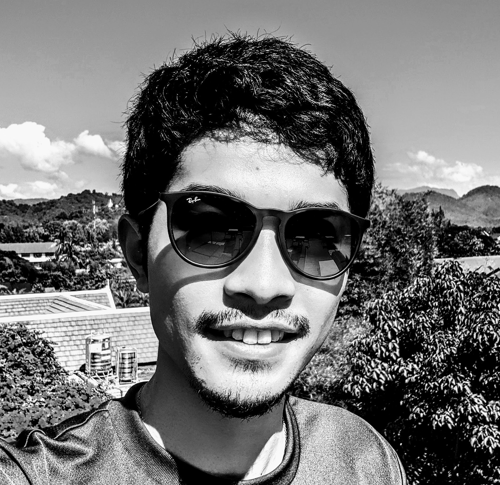

# About Me

FUJITAKE Masato (藤武将人) is a Co-Founder of Fast Accounting, Ltd., Tokyo, Japan, and Research Director of its research division, FA Research.

His research focuses on the end-to-end development of high-performance domain-specific large language models (LLMs), particularly for accounting and financial applications. His work spans the entire model development pipeline, including **data collection and corpus construction, pretraining from scratch, mid-training, post-training, reinforcement learning, and context-window extension**.

He has been developing **Deep Dean**, an accounting-specialized LLM that has substantially outperformed general-purpose frontier models in selected accounting-domain evaluations.

To advance domain-specific LLMs, he also investigates generalizable methods for improving model performance, training efficiency, and stability. His recent research includes **EnergyCal** and **MESH**, focusing on optimization techniques for Mixture-of-Experts (MoE) training. He also develops and releases experimental general-purpose language models through [Hugging Face](https://huggingface.co/FastAccounting). While the domain-specific models themselves are proprietary, he actively publishes broadly applicable methods and research findings derived from their development.

Previously, his research centered on computer vision, optical character recognition, and document understanding, resulting in publications at international conferences including WACV, ICASSP, and LREC-COLING.

He received his Ph.D. in Information Science and Technology from the Graduate University for Advanced Studies (SOKENDAI) in 2022, where he conducted research at the [Computer Vision and Discrete Geometry Group (Sugimoto Laboratory)](http://www.dgcv.nii.ac.jp/index.html) at the National Institute of Informatics (NII). He earned his bachelor's and master's degrees from Shibaura Institute of Technology in Tokyo, Japan.

He has also contributed to open-source projects, including [torchstat](https://github.com/Swall0w/torchstat) and [Nobunaga](https://github.com/FastAccounting/nobunaga).

## Research Interests

- Domain-Specific Large Language Models
- End-to-End LLM Development and Training
- Data Curation and Corpus Construction
- Pretraining, Mid-Training, and Post-Training
- Reinforcement Learning and Long-Context Modeling
- Efficient Optimization and Mixture-of-Experts (MoE)

# News (Selected Updates)

- **2026/10:** My paper **"EnergyCal: Taming Loss Spikes in Muon-Family Optimizers for Sparse MoE Training"** is available on [arXiv](https://arxiv.org/abs/2610.37062).
- **2026/08:** My paper **"MESH: Memory-Efficient Sinkhorn Optimization for Mixture-of-Experts Training"** is available on [arXiv](https://arxiv.org/abs/2608.04407).
- **2026/07:** Our experimental MoE language model, **[Rize-0.6-tiny](https://huggingface.co/FastAccounting/Rize-0.6-tiny)**, is publicly available on Hugging Face.
- **2026/03:** Our earlier research model, **[Rize-0.5-tiny](https://huggingface.co/FastAccounting/Rize-0.5-tiny)**, is available on Hugging Face.
- **2026/01:** Our accounting-specialized LLM, **Deep Dean**, achieved **99.8% accuracy on the Japanese Bookkeeping Level 1 examination**. [Details](https://www.fastaccounting.jp/news/20260126/15632/)
- **2025/04:** We announced **Deep Dean**, an accounting-specialized LLM demonstrating strong performance on professional accounting examinations, including the USCPA. [Details](https://www.fastaccounting.jp/news/20250416/14135/)
- **2024/09:** My paper **"JaPOC: Japanese Post-OCR Correction Benchmark using Vouchers"** was accepted to PRICAI 2024. [arXiv](https://arxiv.org/abs/2409.19948)
- **2024/04:** My paper **"JSTR: Judgment Improves Scene Text Recognition"** was published on [arXiv](https://arxiv.org/abs/2404.05967).
- **2024/03:** My paper **"LayoutLLM: Large Language Model Instruction Tuning for Visually Rich Document Understanding"** was accepted to LREC-COLING 2024. [arXiv](https://arxiv.org/abs/2403.14252)

For a complete list of publications, see my [arXiv author page](https://arxiv.org/search/cs?searchtype=author&query=Fujitake%2C+M).

---

# Education

<dl>
<dt>Ph.D. in Information Science and Technology, 2022</dt>
<dd>The Graduate University for Advanced Studies, SOKENDAI</dd>
<dt>Master of Electrical, Electronic and Communications Engineering, 2019</dt>
<dd>Shibaura Institute of Technology, Tokyo</dd>
<dt>Bachelor of Electrical Engineering Technologies, 2017</dt>
<dd>Shibaura Institute of Technology, Tokyo</dd>
</dl>

# Work Experience

- Research Director, 2024/01 ~ present, Fast Accounting, Japan
- Chief Research Scientist, 2023/02 ~ 2024/01, Fast Accounting, Japan
- Research Scientist, 2022/04 ~ 2023/02, Fast Accounting, Japan
- Research Assistant, 2020/04 ~ 2022/02, National Institute of Informatics, Japan
- Research Engineer, 2016/11 ~ 2022/03, Fast Accounting, Japan
